# 3. Manual de la aplicación móvil Android

**EventU 1.0.0.** La aplicación móvil es una APK independiente de la web. Utiliza la misma cuenta y requiere conexión a internet para consultar información y registrar operaciones.

## 3.1. Descargar e instalar

**Dirigido a:** personas que utilizarán EventU desde Android.

1. Desde el teléfono, abra la [release EventU Mobile v1.0.0](https://github.com/atlas-interactive/eventu-mobile/releases/tag/v1.0.0).
2. En **Assets**, descargue **EventU-v1.0.0.apk**. También puede usar el [enlace directo a la APK 1.0.0](https://github.com/atlas-interactive/eventu-mobile/releases/download/v1.0.0/EventU-v1.0.0.apk).
3. Abra el archivo descargado.
4. Si Android solicita autorizar instalaciones desde esa aplicación, habilite el permiso para el navegador o gestor de archivos que está utilizando y regrese al instalador. Los nombres de estos controles pueden variar según el teléfono.
5. Seleccione **Instalar** y, al finalizar, **Abrir**.

**Resultado:** EventU aparece entre las aplicaciones del teléfono. No necesita instalar herramientas de desarrollo para utilizar esta APK.

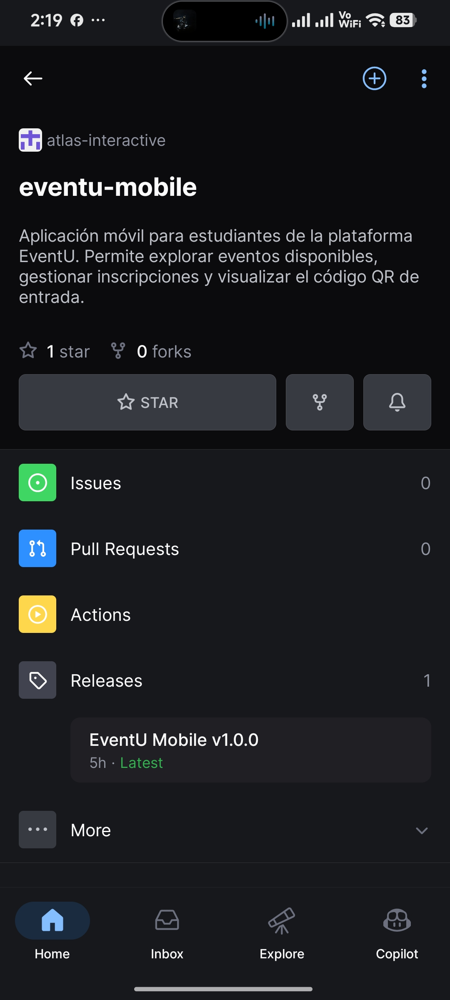

**Figura 21.** Acceso a la release desde el repositorio en GitHub.

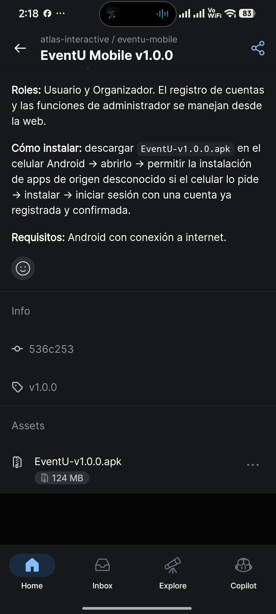

**Figura 22.** Archivo EventU-v1.0.0.apk disponible para descargar.

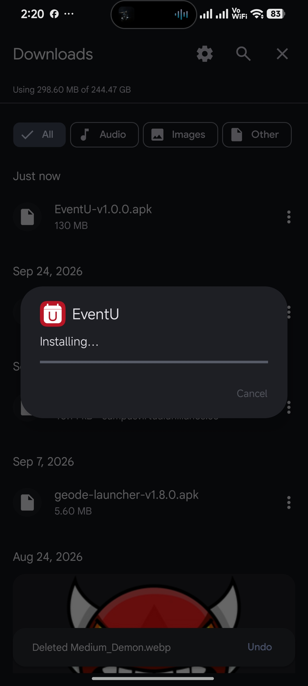

**Figura 23.** Instalación de EventU en Android.

## 3.2. Iniciar sesión y reconocer las pestañas

**Dirigido a:** cuentas registradas con rol Usuario u Organizador.

1. Si aún no tiene cuenta, créela en la [web de EventU](https://eventu-web-sigma.vercel.app/) y complete la confirmación del correo cuando se solicite.
2. Abra la APK e ingrese su **Correo institucional** y **Contraseña**.
3. Pulse **Iniciar sesión**.
4. Si aparece el aviso de cuenta reactivada, lea el mensaje y pulse **Continuar**.

**Resultado:** accede a las pestañas **Eventos**, **Inscripciones** y **Perfil**. Para crear una cuenta, recuperar la contraseña o reenviar una confirmación, utilice los formularios de la web; la pantalla de acceso móvil ofrece el inicio de sesión.

| Pestaña | Uso |
| --- | --- |
| Eventos | Explorar el catálogo, abrir el detalle e inscribirse. El Organizador puede activar Solo mis eventos para gestionar la asistencia de sus actividades. |
| Inscripciones | Consultar la agenda personal, mostrar la entrada y cancelar una inscripción cuando esté permitido. |
| Perfil | Consultar y editar el nombre, cambiar la contraseña, ajustar accesibilidad, desactivar la cuenta y cerrar sesión. |

El rol Administrador no puede iniciar sesión en la APK: la pantalla indica que debe ingresar desde el panel web. Los procedimientos de administración, creación de eventos, reportes y estadísticas se realizan en la web. Este capítulo explica el uso de la APK por el participante y el organizador durante los eventos.

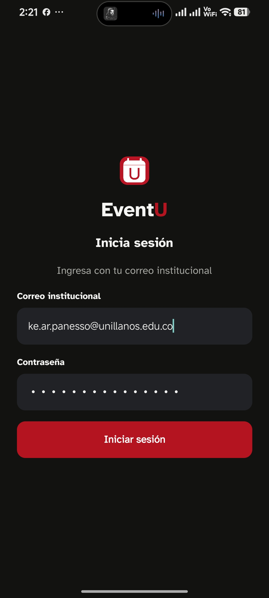

**Figura 24.** Acceso con la cuenta institucional.

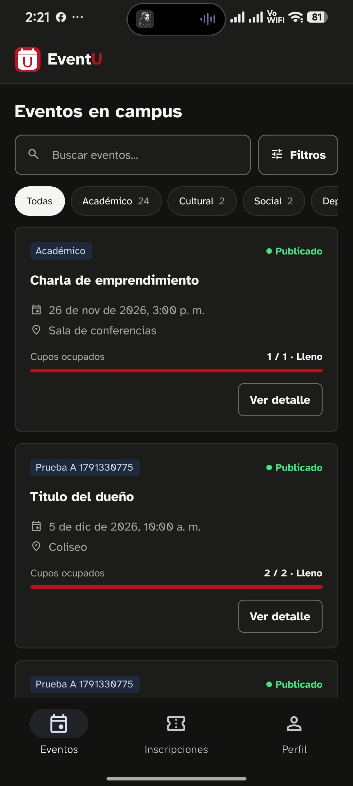

**Figura 25.** Catálogo y navegación principal de la aplicación.

## 3.3. Buscar eventos y consultar información

**Dirigido a:** Usuario y Organizador que busca eventos ajenos.

1. Abra **Eventos**.
2. Utilice la búsqueda por título y abra los filtros para elegir categoría o fechas.
3. Cambie el orden si necesita ver primero una fecha o un título.
4. Pulse **Ver detalle** en la tarjeta de la actividad.
5. Revise descripción, fecha y hora, ubicación, categoría, organizador y cupos. La marca **Con certificado** identifica un evento certificable.

**Resultado:** puede evaluar el evento antes de inscribirse. Si los filtros no devuelven resultados, límpielos o cambie el rango. La consulta ordinaria no ofrece eventos cancelados ni los que ya iniciaron como nuevas actividades disponibles para inscripción.

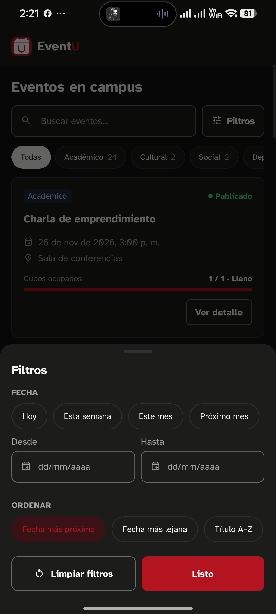

**Figura 26.** Filtros de fecha y opciones para ordenar el catálogo.

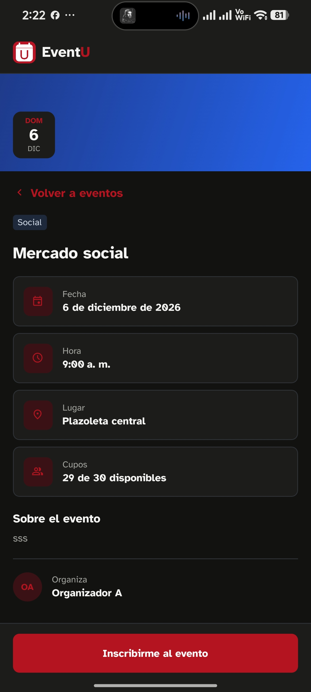

**Figura 27.** Información del evento y botón de inscripción.

## 3.4. Inscribirse

**Dirigido a:** Usuario u Organizador que asiste a un evento de otro organizador.

1. Abra un evento publicado, futuro y con cupos disponibles.
2. Pulse **Inscribirme al evento**.
3. Espere la confirmación **Estás inscrito**.
4. Pulse **Ver mi entrada** para consultar el QR, o entre después a **Inscripciones**.

**Resultado:** su inscripción reserva un cupo y queda disponible también desde la web. No puede duplicar una inscripción activa ni inscribirse en un evento propio. El Administrador no puede reservar cupos como asistente.

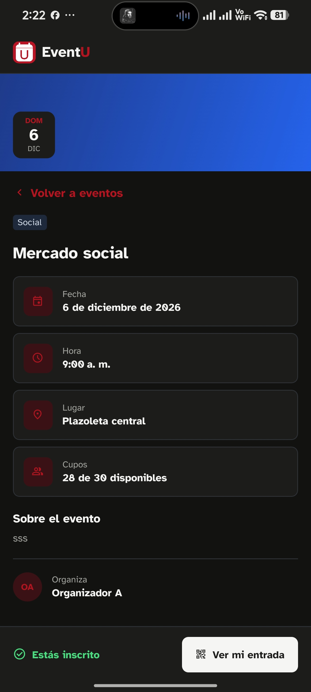

**Figura 28.** Detalle del evento después de inscribirse.

## 3.5. Consultar la agenda y presentar el QR

**Dirigido a:** Usuario y Organizador inscrito en un evento ajeno.

1. Abra **Inscripciones** y seleccione **Todas**, **Activas** o **Canceladas**.
2. Cambie al mes del evento y seleccione el día para ver su agenda.
3. Abra el QR de la inscripción vigente. También puede abrir el detalle del evento y pulsar **Ver mi entrada**.
4. Presente la pantalla al organizador en el acceso al evento. Mantenga visible el QR completo.
5. Si no puede leerse con la cámara, muestre el código escrito que aparece debajo para que el organizador lo ingrese manualmente.
6. Pulse **Listo** para cerrar la entrada.

**Resultado:** el organizador dispone del código de su inscripción para validarlo. Mostrarlo no registra automáticamente la asistencia; espere la confirmación del organizador.

Una inscripción cancelada no ofrece un QR vigente. La aplicación deja de mostrar la entrada cuando termina el día del evento. Un Organizador presenta su QR como cualquier participante cuando está inscrito en la actividad de otro organizador.

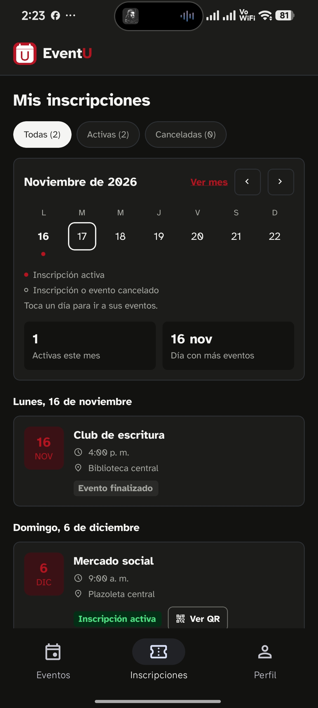

**Figura 29.** Calendario personal y consulta de inscripciones.

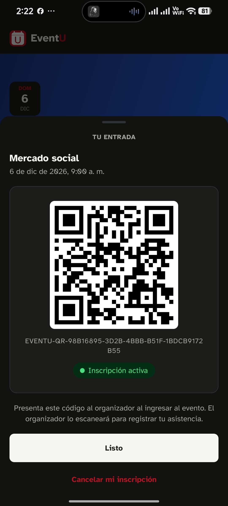

**Figura 30.** Entrada QR para presentar al organizador.

## 3.6. Cancelar una inscripción

**Dirigido a:** Usuario y Organizador participante.

1. Antes del inicio del evento, ubique la inscripción en su agenda o abra su entrada.
2. Seleccione la opción de cancelar la inscripción.
3. Revise el nombre del evento en el diálogo y pulse **Confirmar cancelación**.

**Resultado:** se libera el cupo y la inscripción se conserva como Cancelada. No puede cancelar una inscripción ajena, ya cancelada, con asistencia registrada o cuyo evento ya inició. Puede volver a inscribirse si el evento sigue disponible y tiene cupos.

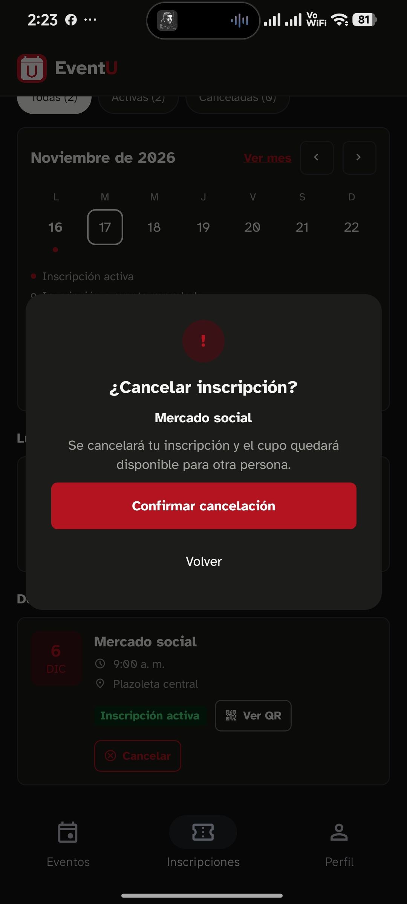

**Figura 31.** Confirmación antes de cancelar la reserva y liberar el cupo.

## 3.7. Consultar los inscritos de un evento propio

**Dirigido a:** Organizador.

1. En **Eventos**, active **Solo mis eventos**.
2. Abra **Ver detalle** en uno de sus eventos.
3. Pulse **Inscritos y asistencia**.
4. Consulte el total de inscritos, el número de asistentes y los estados **Asistió** o **Pendiente** de cada participante.
5. Utilice **Buscar participante** para localizar un nombre o correo.

**Resultado:** dispone del listado para controlar el acceso. Si aún no tiene eventos, créelos desde la web. La vista de eventos propios excluye los cancelados, que ya no requieren registrar asistencia.

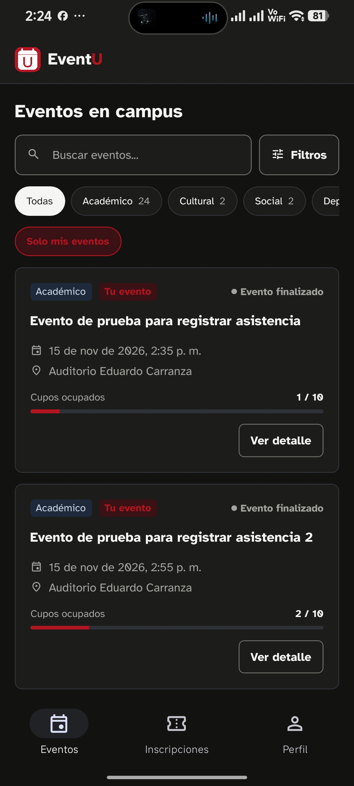

**Figura 32.** Consulta de eventos propios del Organizador.

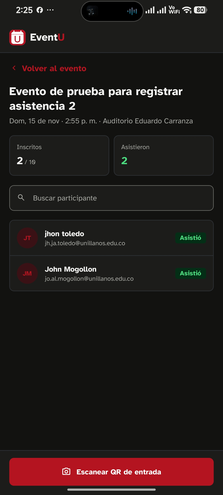

**Figura 33.** Inscritos, asistencias registradas y acceso al escáner.

## 3.8. Escanear un QR y registrar asistencia

**Dirigido a:** Organizador del evento.

**Antes de empezar:** debe tener acceso al evento, conexión a internet y una inscripción activa del participante sin asistencia previa. El evento no debe estar cancelado.

1. Desde **Inscritos y asistencia**, pulse **Escanear QR de entrada**.
2. Si se solicita, pulse **Permitir cámara** y acepte el permiso de Android. Si el permiso está desactivado y no se puede solicitar otra vez, pulse **Abrir ajustes** y habilítelo desde el teléfono.
3. Apunte la cámara al QR del participante, procurando mantenerlo completo dentro de la imagen.
4. Espere a que termine **Validando…**.
5. Compruebe el mensaje **Asistencia registrada**, el nombre del participante, el evento y la hora. Revise el evento indicado antes de continuar con la siguiente persona.
6. Regrese a los inscritos para consultar el estado actualizado.

**Resultado:** queda registrada la asistencia. La validación vuelve a comprobar el código en el sistema; no basta con reconocer visualmente el QR. Un mismo código no registra dos asistencias para la misma inscripción.

Si presenta un código de otro de sus eventos, el resultado identifica ese evento y puede mostrar un aviso al respecto. Compruebe siempre que corresponde a la actividad a la que está dando acceso.

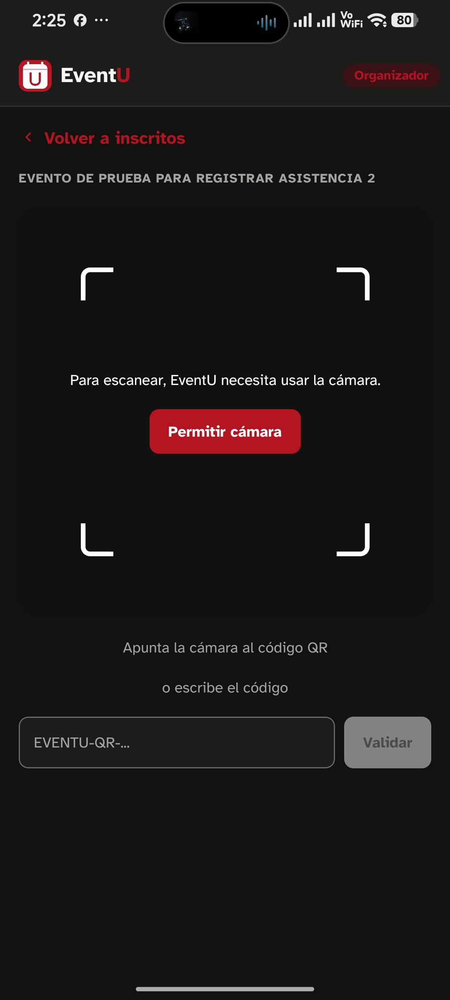

**Figura 34.** Solicitud de acceso a la cámara y campo para ingreso manual del código.

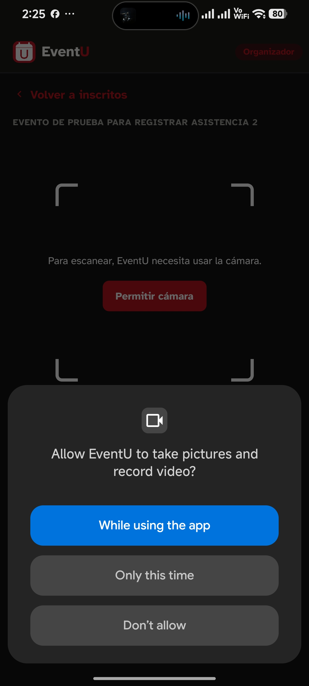

**Figura 35.** Autorización de cámara desde Android. El diálogo del sistema aparece en inglés en este dispositivo; **While using the app** permite el acceso mientras se utiliza la aplicación.

### 3.8.1. Ingresar el código manualmente

1. En la pantalla del escáner, localice **o escribe el código**.
2. Copie o escriba el código completo que el participante muestra debajo de su QR.
3. Pulse **Validar** y compruebe el resultado igual que en el escaneo.

**Resultado:** el sistema realiza la misma validación y registra la asistencia si corresponde. Es una alternativa cuando no puede utilizar la cámara; también requiere internet.

El campo para escribir el código y el botón **Validar** se muestran en la figura 34.

### 3.8.2. Resolver una validación rechazada

| Mensaje o condición | Cómo proceder |
| --- | --- |
| Código QR inválido | Pida al participante que abra la entrada vigente y compruebe el código completo. |
| Asistencia ya registrada | Compruebe el participante en el listado; no se crea otro registro. |
| Inscripción cancelada | La entrada no habilita el acceso como inscripción activa. Revise el estado con el participante. |
| Evento cancelado | No continúe registrando asistencias de esa actividad. |
| Sin permiso | Compruebe que inició sesión con la cuenta organizadora correspondiente. |
| Error de conexión | Restablezca internet y consulte el listado antes de repetir la validación, para comprobar si la operación llegó a registrarse. |

## 3.9. Obtener el certificado de asistencia

**Dirigido a:** Usuario u Organizador inscrito como participante.

1. Abra el detalle del evento desde su inscripción.
2. Si el evento es certificable y ya inició, pulse **Descargar certificado (PDF)**.
3. Una vez generado el documento, utilice las opciones de Android para abrirlo, compartirlo o guardarlo, según las aplicaciones disponibles en el teléfono.

**Resultado:** obtiene el PDF con su nombre y los datos del evento cuando tiene inscripción activa y asistencia verificada. Si aparece **Disponible cuando se verifique tu asistencia**, consulte al organizador. El botón no se ofrece antes del inicio ni en eventos no certificables.

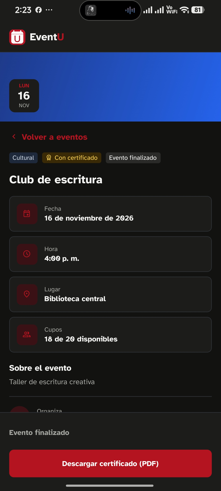

**Figura 36.** Acceso a la descarga del certificado en un evento certificable que ya finalizó. La imagen muestra el botón de descarga, no el PDF generado.

## 3.10. Consultar y modificar el perfil

**Dirigido a:** Usuario y Organizador.

1. Abra **Perfil** y consulte nombre, correo institucional, rol y fecha de registro.
2. Pulse **Editar información**.
3. Modifique el nombre y pulse **Guardar cambios**. Use **Cancelar** para salir sin guardar.

**Resultado:** se actualiza el nombre de la cuenta. El nombre es obligatorio y admite hasta **100 caracteres**. El correo no se modifica y el rol se administra desde la web.

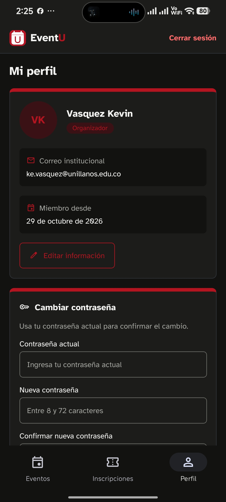

**Figura 37.** Consulta del perfil y acceso a la edición de información.

### 3.10.1. Cambiar la contraseña

1. En **Perfil**, ubique **Cambiar contraseña**.
2. Ingrese la contraseña actual, la nueva de **8 a 72 caracteres** y su confirmación.
3. Pulse **Actualizar contraseña** y compruebe el mensaje de resultado.

**Resultado:** se actualiza la contraseña, se cierran las demás sesiones y se envía un aviso por correo. Si la olvidó, abra la recuperación en la web.

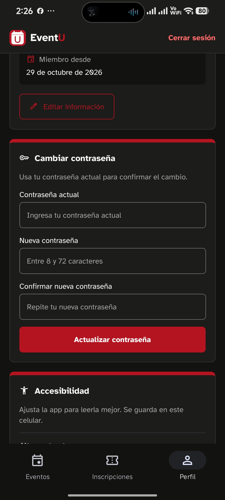

**Figura 38.** Cambio de contraseña desde el perfil móvil.

### 3.10.2. Desactivar la cuenta y cerrar sesión

Para desactivar la cuenta, lea las condiciones en **Perfil**, pulse **Desactivar mi cuenta**, ingrese su contraseña y confirme. La cuenta se conserva, se cierra la sesión y se cancelan las inscripciones activas de eventos futuros. Si es Organizador y tiene eventos publicados pendientes, debe cancelarlos o esperar a que finalicen antes de desactivar la cuenta. Puede reactivar la cuenta iniciando sesión con sus credenciales correctas.

Para salir sin desactivar su cuenta, pulse el control **Cerrar sesión** en el encabezado de **Perfil**. Volverá al inicio de sesión y conservará sus inscripciones.

El acceso a **Cerrar sesión** se muestra en la figura 37; las condiciones y el botón **Desactivar mi cuenta** aparecen en la figura 39.

## 3.11. Ajustar accesibilidad y apariencia

**Dirigido a:** Usuario y Organizador.

1. Abra **Perfil** y ubique **Accesibilidad**.
2. Active **Alto contraste** si necesita mayor contraste entre textos y bordes.
3. Active **Modo daltonismo** para utilizar azul y naranja en lugar de verde y rojo.
4. Elija **Pequeña**, **Normal** o **Grande** en **Tamaño de letra**.

**Resultado:** las preferencias se aplican y se guardan en ese teléfono. La apariencia clara u oscura sigue la configuración de tema del dispositivo. Estos ajustes son independientes de los guardados en el navegador web.

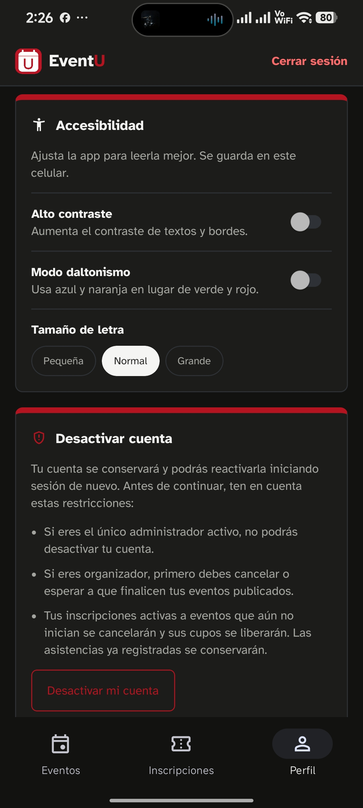

**Figura 39.** Preferencias de accesibilidad y condiciones para desactivar la cuenta.
