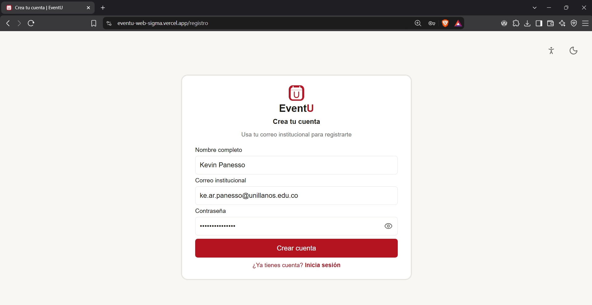

# Manuales de usuario de EventU — versión 1.0.0

Esta carpeta reúne los capítulos del manual web y del manual de la aplicación Android. Comparten introducción y solución de problemas para poder integrarse posteriormente en un documento único.

## Orden del entregable

1. [Introducción, requisitos y roles](00-introduccion.md).
2. [Manual de la aplicación web](01-manual-web.md).
3. [Manual de la aplicación móvil Android](02-manual-movil.md).
4. [Solución de problemas y glosario](03-solucion-de-problemas.md).

Para entregar cada manual por separado, acompañar el capítulo correspondiente con la introducción y la solución de problemas. Para unirlos, conservar ese orden y generar al final el índice y la numeración de figuras en Word o en la herramienta de exportación elegida.

## Material de preparación

- [Guía de capturas por procedimiento](guia-de-capturas.md): nombres de archivo, rol, preparación y momento de la captura.
- [Cobertura de las 20 historias y fuentes](cobertura-y-fuentes.md): relación entre requisitos, procedimientos y código consultado. Es material de revisión, separado del texto destinado al usuario final.
- `imagenes/web/` e `imagenes/movil/`: carpetas para guardar las imágenes según la guía.

## Estado de esta edición

El texto se preparó a partir de los criterios de aceptación y del código disponible el 17 de noviembre de 2026. Se revisaron y se integraron las 20 capturas web entregadas por el responsable, correspondientes a Usuario, Organizador y Administrador. Las figuras están numeradas del 1 al 20 y conservan los nombres de archivo recibidos. Las imágenes móviles siguen pendientes.

Las capturas permiten contrastar los textos y controles visibles, pero no prueban por sí solas el funcionamiento completo de cada procedimiento. La revisión interactiva y la revisión del documento exportado siguen pendientes.

Los comentarios `<!-- CAPTURA: ... -->` indican dónde insertar las figuras. No son imágenes faltantes ni forman parte del texto impreso. Al recibir cada imagen:

1. Comprobar que corresponde a la versión 1.0.0 y al estado indicado en la guía.
2. Guardarla con el nombre acordado.
3. Sustituir el comentario por una imagen Markdown con una descripción, por ejemplo:

   ```markdown
   

   Figura: Registro de una cuenta institucional.
   ```

4. Corregir cualquier diferencia de nombres o navegación que revele la captura.
5. Al integrar los capítulos, numerar las figuras de forma continua y revisar los saltos de página y el índice.

No se ejecutaron operaciones sobre cuentas, eventos o asistencias reales para redactar estos documentos.
